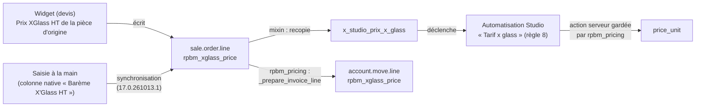

# Interaction avec rpbm_pricing

[Index](../README.md) › Technique › Interaction avec rpbm_pricing

`rpbm_pricing` est un module **optionnel** posé au-dessus de `rpbm_agent` (son `depends` contient `rpbm_agent`,
voir [`rpbm_pricing/__manifest__.py`](../../../rpbm_pricing/__manifest__.py)). L'inverse est faux : `rpbm_agent`
ne dépend pas de `rpbm_pricing` et fonctionne seul. Cette page décrit ce que les deux modules partagent. Le
détail du second est dans sa propre [documentation](../../../rpbm_pricing/docs/README.md).

## Ce qui est partagé : `rpbm_xglass_price`

Le champ `sale.order.line.rpbm_xglass_price` (« Barème X'Glass HT » depuis `17.0.261015.1`, auparavant « Prix X'Glass », `models/sale_order.py`) est le seul point de
contact. `rpbm_agent` le déclare et l'alimente ; `rpbm_pricing` le lit.

## Règle 8 gardée

L'automatisation « Tarif x glass » (automatisation 8, action serveur 1510 sur la préproduction, d'après
`rpbm_pricing/models/legacy_fields.py`) écrit `price_unit = Prix X'Glass × 1,5`. Quand `rpbm_pricing` est
installé :

- **Installation de la garde.** `rpbm_pricing/hooks.py:15` appelle `_rpbm_rule8_install` à l'installation. La valeur de
  l'action devient `record.rpbm_rule8_price` si ce champ existe, sinon la formule d'origine. Rien n'est changé
  dans `rpbm_agent`.
- **Ce que la garde décide.** `_rpbm_rule8_value` (`rpbm_pricing/models/sale_order_line_rule8.py:55`) laisse le prix
  inchangé pour une ligne sans barème, un article de service ou une catégorie de consommable, de film solaire ou
  de services. Si le paramètre `rpbm_pricing.rule8_insurance_only` vaut `1` (défaut `0`), elle ne majore pas non
  plus les dossiers hors assurance (`sale_order_line_rule8.py:65`). Le coefficient (défaut 1,5) est le paramètre
  `rpbm_pricing.insurance_coefficient`.
- **Quantité.** Avec la garde active, `_compute_price_unit` (`rpbm_pricing/models/sale_order_line_rule8.py`, surcharge du calcul natif) donne à la ligne le prix de la règle 8 quand sa quantité change, au lieu du prix de la liste de prix. Une ligne dont le prix a été saisi à la main revient donc à Prix X'Glass × coefficient. Les lignes déjà facturées restent au calcul natif.
- **Sans `rpbm_pricing`.** L'action garde sa formule d'origine : la majoration de 1,5 s'applique à toute ligne
  dont le Prix X'Glass change. C'est le comportement documenté dans [`sale.order.line`](champs/sale-order-line.md).

Le commentaire du champ (`models/sale_order.py:153-155`) le dit : « Barème X'Glass de la ligne ; l'automatisation
Studio « Tarif x glass » en dérive `price_unit` (gardée par `rpbm_pricing` quand il est installé) ».

## Ce que le widget écrit dans ce champ

Deux formulations circulent, et les deux sont exactes à leur niveau :

- le **champ** est un barème X'Glass générique : n'importe quelle ligne peut le porter, y compris une ligne saisie
  à la main ;
- le **widget** y écrit, depuis `17.0.261015.1`, le Prix XGlass HT de la pièce d'origine choisie
  (`rpbm_xglass_piece_price` du dossier, décision Q-01 du client, [VD-08](../validations-metier.md#historique-des-décisions)),
  pour l'article VSF principal seulement ; rien sans pièce d'origine. Avant (VM-10, remplacé), il y écrivait le prix
  RPBM de l'article VSF, `articleVsf.prixVenteRPBM`, qui va désormais dans le prix fournisseur de la ligne
  (`rpbm_supplier_price`), jamais lu par la règle 8. Exemple SO7970 : 322,38 × 1,5 = 483,57 au lieu de 211,16 × 1,5 = 316,74.

## Reprise sur la facture

`rpbm_pricing` ajoute `account.move.line.rpbm_xglass_price` (« Barème X'Glass », `models/account_move_line.py:8`)
et le remplit depuis la ligne de devis lors de la facturation (`models/sale_order_line_invoice.py:11`, lignes
produit seulement). Ce champ sert au contrôle ; aucune vue ni impression ne l'affiche.

## Lien avec la synchronisation Studio

La garde ne sert à rien si le Prix X'Glass saisi à la main n'arrive pas dans `rpbm_xglass_price` : l'automatisation
ne se déclenche que sur le champ Studio. Le correctif `17.0.261013.1` (voir
[priorité en cas de double saisie](configuration.md#priorité-en-cas-de-double-saisie)) garantit qu'une saisie
Studio l'emporte sur le natif vide envoyé par le formulaire. Il a été trouvé à la recette de `rpbm_pricing` du
2026-10-13.

---
Précédent : [Tests](tests.md) · Suivant : [Historique des versions](versions.md)

Voir aussi : [Architecture](architecture.md) · [Documentation — RPBM Pricing](../../../rpbm_pricing/docs/README.md) · [Champs — `sale.order.line`](champs/sale-order-line.md) · [Configuration & déploiement](configuration.md)
