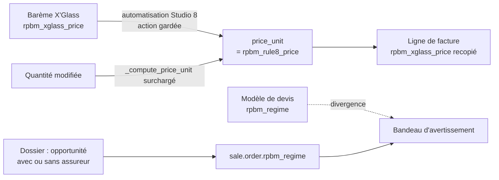

# Documentation — RPBM Pricing

[RPBM Pricing](../README.md) › Documentation

Index de la documentation du module `rpbm_pricing` (version `17.0.261012.1`), qui s'installe au-dessus de
`rpbm_agent`. À tenir à jour à chaque version déployée.

## Lecteurs visés et sommaire

| Vous êtes | Lisez |
|---|---|
| vendeur, acheteur, comptable ou administrateur de RPBM | [Manuel utilisateur](utilisateur/README.md) : ce qui change à l'écran, tâche par tâche |
| développeur ou personne qui déploie le module | [Manuel technique](technique/README.md) : modèles, règle 8, colisage, paramètres, installation, tests, recette |

Pages du manuel technique les plus consultées : [Paramètres](technique/parametres.md) ·
[Règle 8](technique/regle-8.md) · [Colisage VSF](technique/colisage.md) ·
[Recette](technique/recette-jev.md).

## Chaîne de prix couverte

## Périmètre de l'itération 1

Le module reste en mode « règle 8 » : c'est le seul mode possible en production tant que le widget de
`rpbm_agent` n'écrit pas le Prix XGlass HT (IMP-1) ni le prix fournisseur brut (IMP-3 côté widget).

| Lot | Livré | Code |
|---|---|---|
| Socle régime (P-05, P-16) | Régime du dossier calculé, relais du modèle de devis, bandeau de divergence et bandeau « main-d'œuvre X'Glass sur un dossier hors assurance » | `lib/regime.py`, `models/sale_order_regime.py`, `models/sale_order_template.py` |
| IMP-2 | Garde de la règle 8 : services et catégories 19, 20, 22 exclus, coefficient et arrondi en paramètres, quantité qui ne casse plus le prix, retour arrière sans désinstallation | `models/sale_order_line_rule8.py`, `data/rule8_data.xml` |
| IMP-6 (code) | Le client livré n'est plus candidat fournisseur (P-36) | `models/stock_rule.py` |
| IMP-8 (partie) | Mode avion ou bateau sur l'achat ; un brouillon bateau ne reçoit pas les besoins automatiques (P-47) | `models/purchase_order.py`, `models/stock_rule.py` |
| IMP-7 | Colisage VSF, DAU, rattachements, coefficient, colisage retenu, coefficient annuel, reprise 2025-2026 | `lib/colisage.py`, `models/rpbm_colisage*.py` |
| IMP-10 (partie) | Barème recopié sur la ligne de facture ; net et remise fournisseur jamais imprimés (P-24, testé) | `models/account_move_line.py`, `models/sale_order_line_invoice.py` |

Une seule version de manifeste pour toute l'itération : le module n'a jamais été déployé en production (il tourne en préprod depuis le 2026-10-13), sa mise en place
passe par `post_init_hook` → `hooks.setup(env)` et il n'a pas de dossier `migrations/`. Une version suivante
qui ajoute une mise en place livrera `migrations/<version>/post-setup.py` (voir [`../CLAUDE.md`](../CLAUDE.md)).

## Différé, et pourquoi

| Sujet | Attend |
|---|---|
| Filtre de date et arrondi effectif de la règle 8 | Q-12 |
| Activation du filtre de régime de la règle 8 | Validation du client ([Paramètres](technique/parametres.md)) |
| IMP-3 côté prix (prix de revient) | IMP-3 côté widget : le prix fournisseur est encore un net, faux de 20 % |
| IMP-4 (listes de prix par régime, bascule) | IMP-1, IMP-3, Q-04, Q-08, Q-09, Q-12, Q-13 |
| IMP-5 (main-d'œuvre et pose) | Q-14 à Q-17, E-02 |
| IMP-8 : fournisseur prévu, position fiscale, achat local, points de commande | Q-20, Q-23, E-01, Q-21, Q-22 |
| IMP-9 | IMP-7, IMP-8, Q-07, Q-19, E-03, E-04 |
| IMP-10 : avoirs typés, mise en demeure, franchise | Q-09, Q-10, Q-11, E-02 |
| IMP-11 | Choix de l'option (Q-06, Q-07, Q-12, E-05, F-01 à F-03) |
| Rattachement systématique des réceptions au colisage | Q-19 (P-42) |

**Avant la production** : `rpbm_agent` doit recopier les champs Studio vers ses champs natifs à son
installation (lot WPA), sinon `rpbm_xglass_price` reste nul sur l'historique ; IMP-1, DOC-10 et IMP-0 doivent
être livrés.

Le plan qui fait foi est `.paradigme/audits/rpbm_pricing/plan-iteration-1.md` à la racine du dépôt (local,
non suivi par Git) : choix d'architecture, lots, critiques retenues et risques.

Voir aussi : [Manuel technique](technique/README.md) · [`../README.md`](../README.md) (présentation du module) ·
[`../../rpbm_agent/docs/README.md`](../../rpbm_agent/docs/README.md) (module socle).

---
Suivant : [Manuel utilisateur](utilisateur/README.md)
