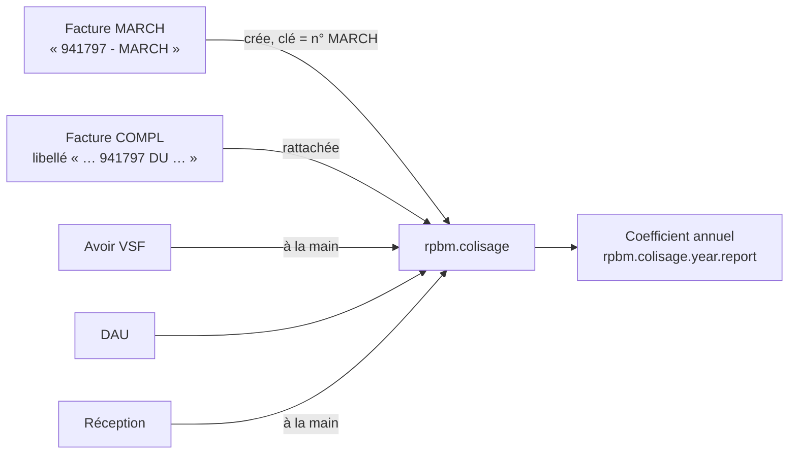

# Colisage VSF

[RPBM Pricing](../README.md) › [Documentation](README.md) › Colisage VSF

Lot IMP-7. Un colisage est un envoi VSF (la « caisse » du client), identifié par le numéro de sa facture
MARCH. Il regroupe la MARCH, les COMPL (transport, octroi de mer), les avoirs, les DAU et les réceptions, et
calcule son coefficient d'approche. Principes P-40 et P-41 de l'architecture (`docs/architecture/colisage-frais-approche.md`
à la racine du dépôt, non suivi par Git).

## Modèles

| Modèle | Rôle |
|---|---|
| `rpbm.colisage` | N° MARCH (unique), fournisseur, mode avion ou bateau (suivi), date, année, facture MARCH (unique), factures, réceptions, DAU, montants calculés, fil de discussion |
| `rpbm.colisage.dau` | N° DAU, date, octroi de mer, TVA pour information. Les pièces justificatives vont dans le fil du colisage |
| `rpbm.colisage.year.report` | Vue SQL, une ligne par année : coefficient global des colisages retenus |
| `account.move.rpbm_colisage_id`, `stock.picking.rpbm_colisage_id` | Rattachement ; visibles des seuls acheteurs (Q-23) |

Logique pure dans [`../lib/colisage.py`](../lib/colisage.py), modèles dans
[`../models/rpbm_colisage.py`](../models/rpbm_colisage.py) et
[`../models/rpbm_colisage_report.py`](../models/rpbm_colisage_report.py).

## Montants et coefficient

Calculés sur les lignes produit des factures **postées** rattachées ; une facture « PACK VIN » est ignorée.

| Règle | Contenu |
|---|---|
| Pièces | compte commençant par 60710000, ou libellé contenant PIECE |
| Frais | toutes les autres lignes (port, transport, octroi de mer) |
| Exclu | ligne dont le libellé contient PACK VIN |
| Avoir | déduit (signe −1) |
| Coefficient | (pièces + frais) / pièces ; 0 sans pièces |
| Retenu | pièces > `colisage_min_pieces` (500) **et** frais > `colisage_min_fees` (629), strictement |

Montants en devise de la société (raccourci assumé : les factures VSF sont en euros). Les seuils ne sont pas
des dépendances du calcul : après un changement de seuil, relancer la reprise, qui recalcule tous les
colisages. La TVA d'importation reste autoliquidée et n'entre jamais dans les frais.

Le **coefficient annuel** (menu *Achats › Colisages VSF › Coefficient annuel*) se calcule à partir des sommes
de l'année, jamais en additionnant les coefficients des colisages (P-41) : pas de vue pivot.

## Reprise de l'historique

Menu *Achats › Colisages VSF › Reprendre l'historique* (responsable des achats), méthode
`rpbm.colisage._rpbm_import_history(since='2025-01-01')`. Factures et avoirs fournisseur postés du partenaire
VSF (`rpbm_agent.vsf_partner_id`, contacts compris), les MARCH d'abord (une COMPL peut être passée en
comptabilité avant sa MARCH), puis par date et id :

| Référence | Traitement |
|---|---|
| `NNNNNN - MARCH…` | colisage trouvé par numéro, ou par sa facture MARCH s'il a été saisi sous un autre nom, sinon créé (date, facture MARCH, mode) ; facture rattachée |
| `NNNNNN - COMPL…` | colisage cible lu dans un libellé (6 chiffres suivis de « DU »), facture rattachée ; mode passé à bateau si « MARITIME » ; cible introuvable → exception |
| `NNNNNN - PACK VIN` | ignorée |
| autre | exception |
| avoir | compté « à rattacher à la main » |

Une facture déjà rattachée n'est jamais touchée : rejouée, la reprise ne crée ni ne rattache rien de plus.
Le coefficient n'est jamais additionné : en liste regroupée, la colonne reste vide.
Le mode est **bateau** si le numéro figure dans `colisage_boat_marchs`, ou si la référence ou un libellé dit
« MARITIME » ou « BATEAU », sinon avion (Q-18). La notification donne les compteurs et les références en
exception, à rattacher à la main depuis la facture (champ *Colisage VSF*, filtre « Facture fournisseur sans
colisage »).

Exceptions attendues sur l'historique réel : COMPL qui citent leur MARCH sans « DU » (« SUR F767521 ») ou
avec un numéro erroné (« F817816 » pour 817819), et COMPL de janvier 2025 qui visent une MARCH de 2024.

## Paramètres

`rpbm_pricing.colisage_min_pieces`, `colisage_min_fees`, `colisage_boat_marchs` : voir
[Paramètres](parametres.md). Données `noupdate`, valeurs de repli identiques dans `models/params.py`.

## Droits

| Modèle | Acheteur | Responsable des achats |
|---|---|---|
| Colisage, DAU | lire, écrire, créer | tout |
| Coefficient annuel | lire | lire |

Les vendeurs ne voient ni les colisages ni le rattachement. Le groupe « Facturation » n'y donne pas accès : en
préprod il contient tous les vendeurs. L'accès des comptables attend Q-23.

## Tests

- [`../tests/test_colisage_pure.py`](../tests/test_colisage_pure.py) : formes réelles des références, cible des
  COMPL, classement des lignes, avoirs, coefficient, seuils, mode bateau.
- [`../tests/test_colisage.py`](../tests/test_colisage.py) : factures datées 2099 sur le partenaire VSF de
  test ; reprise, montants (pièces 950, frais 929,01, coefficient ≈ 1,9779, retenu), rejeu sans création,
  COMPL orpheline en exception, COMPL maritime, doublon de numéro refusé, facture MARCH déjà portée par un
  colisage d'un autre nom (rattachée sans création), ligne 2099 du coefficient annuel.

## Recette

« Reprendre l'historique » deux fois (la seconde ne crée rien) ; relire les exceptions ; une fois les avoirs
VSF rattachés à la main, coefficient 2025 ≈ 1,883 et 2026 ≈ 1,980 (classeur corrigé). Un écart se documente
avant de continuer.

Voir aussi : [Paramètres](parametres.md)

---
Précédent : [Règle 8](regle-8.md) · Suivant : [Recette](recette.md)
