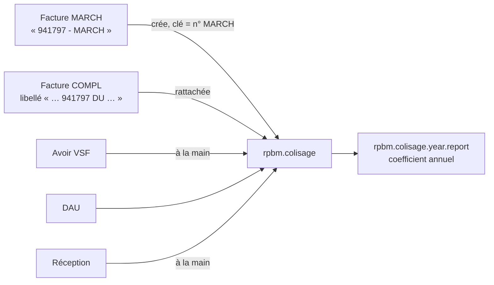

# Colisage VSF

[RPBM Pricing](../../README.md) › [Documentation](../README.md) › [Manuel technique](README.md) › Colisage VSF

Lot IMP-7, principes P-40 et P-41 (`docs/architecture/colisage-frais-approche.md`, local, non suivi par Git).
Un colisage est un envoi VSF, la « caisse » du client, identifié par le numéro de sa facture MARCH. Il
regroupe la MARCH, les COMPL (transport, octroi de mer), les avoirs, les DAU et les réceptions, et calcule son
coefficient d'approche.



Les champs sont décrits dans [Modèles et champs](modeles.md#colisage). Code : logique pure dans
[`lib/colisage.py`](../../lib/colisage.py), modèles dans [`models/rpbm_colisage.py`](../../models/rpbm_colisage.py)
et [`models/rpbm_colisage_report.py`](../../models/rpbm_colisage_report.py).

## Lire une référence de facture

`parse_bill_ref(ref)` ([`lib/colisage.py:27-32`](../../lib/colisage.py)) reconnaît six chiffres, un tiret, puis
`MARCH`, `COMPL` ou `PACK VIN` (insensible à la casse) : « 941797 - MARCH », « 916930 - MARCH BATEAU »,
« 931052 - COMPL MARITIME 2/2 », « 942260 - PACK VIN ». Toute autre forme donne `(None, None)`.

`compl_target(label)` (`:35-38`) lit dans un libellé de COMPL le numéro de la MARCH visée : six chiffres suivis
de « DU » (« FRAIS TRANSPORT 935879 DU 300726 »).

## Montants et coefficient

Calculés par `_compute_amounts` ([`models/rpbm_colisage.py:62-78`](../../models/rpbm_colisage.py)) sur les lignes
produit des factures et avoirs fournisseur **postés** rattachés. Une facture « PACK VIN » est ignorée.

| Règle | Contenu | Source |
|---|---|---|
| Pièces | compte commençant par `60710000`, ou libellé contenant `PIECE` | `lib/colisage.py:41-48` |
| Frais | toutes les autres lignes (port, transport, octroi de mer) | idem |
| Exclu | ligne dont le libellé contient `PACK VIN` | idem |
| Avoir | déduit (signe −1) | `lib/colisage.py:51-63` |
| Coefficient | (pièces + frais) / pièces ; 0 si pièces ≤ 0 | `lib/colisage.py:66-68` |
| Retenu | pièces > `colisage_min_pieces` **et** frais > `colisage_min_fees`, strictement | `lib/colisage.py:71-73` |

Montants en devise de la société (raccourci assumé : les factures VSF sont en euros). La TVA d'importation
reste autoliquidée et n'entre jamais dans les frais. Les seuils ne sont pas des dépendances du calcul : après
un changement, relancer la reprise, qui recalcule tous les colisages (`models/rpbm_colisage.py:137-140`).

## Coefficient annuel

`rpbm.colisage.year.report` est une vue SQL (`_auto = False`) créée par `init()`
([`models/rpbm_colisage_report.py:22-36`](../../models/rpbm_colisage_report.py)). Une ligne par année, sur les
colisages retenus seulement :

```sql
(SUM(c.amount_pieces) + SUM(c.amount_fees)) / NULLIF(SUM(c.amount_pieces), 0) AS coefficient
```

Le coefficient se calcule à partir des sommes de l'année, jamais en additionnant les coefficients des
colisages (P-41). C'est pourquoi `coefficient` a `group_operator=False` et que le rapport n'a pas de vue
pivot. Menu : *Achats › Colisages VSF › Coefficient annuel*.

## Reprise de l'historique

Menu *Achats › Colisages VSF › Reprendre l'historique* (responsable des achats), qui lance l'action serveur
« Reprendre l'historique des colisages VSF » ([`data/rpbm_colisage_data.xml:18-24`](../../data/rpbm_colisage_data.xml)),
laquelle appelle `_rpbm_action_import_history()`, puis `_rpbm_import_history(since="2025-01-01")`
([`models/rpbm_colisage.py:80-162`](../../models/rpbm_colisage.py)).

Factures et avoirs fournisseur postés du partenaire VSF (`child_of`, contacts compris), depuis la date `since`.
Les MARCH passent d'abord (tri stable), car une COMPL peut être passée en comptabilité avant sa MARCH.

| Référence | Traitement |
|---|---|
| déjà rattachée | ignorée |
| avoir | compté « à rattacher à la main » |
| `NNNNNN - PACK VIN` | ignorée |
| `NNNNNN - MARCH…` | colisage trouvé par numéro, ou par sa facture MARCH s'il a été saisi sous un autre nom, sinon créé (date de la facture, mode) ; un colisage saisi à la main sans facture MARCH est complété sans rien écraser ; facture rattachée |
| `NNNNNN - COMPL…` | colisage cible lu dans un libellé, facture rattachée ; mode passé à bateau si « MARITIME » ou « BATEAU » ; cible introuvable : exception |
| autre référence | exception |

Le mode est **bateau** si le numéro figure dans `colisage_boat_marchs`, ou si la référence ou un libellé dit
« MARITIME » ou « BATEAU » (`is_boat`, `lib/colisage.py:76-80`), sinon avion (Q-18).

La méthode renvoie `{created, attached, refunds_to_attach, exceptions}`. La notification d'écran
« Colisages VSF » donne les compteurs et, s'il y en a, les références en exception (type avertissement,
persistante) ; sinon un succès. Les exceptions se rattachent à la main depuis la facture (champ *Colisage VSF*,
filtre « Facture fournisseur sans colisage »).

**Idempotence.** Une facture déjà rattachée n'est jamais touchée : rejouée, la reprise ne crée ni ne rattache
rien de plus. C'est une écriture réelle voulue.

**Exceptions attendues sur l'historique réel** : COMPL qui citent leur MARCH sans « DU » (« SUR F767521 ») ou
avec un numéro erroné (« F817816 » pour 817819), et COMPL de janvier 2025 qui visent une MARCH de 2024.

### Résultat de la recette du 2026-10-13

Build `rpbm-pre-prod-39736343` : 97 colisages, 185 factures rattachées, 4 avoirs à rattacher à la main.
Seconde reprise sans effet. Coefficients avant rattachement des avoirs : 2025 = 1,9027 et 2026 = 1,9408.

Le classeur corrigé attend environ 1,883 et 1,980, une fois les 4 avoirs rattachés. L'écart actuel n'est pas
une erreur : il se réévalue après le rattachement. Un écart qui subsiste après se documente avant de continuer.

## Droits

Voir [Données, paramètres et droits](parametres.md#droits). En résumé : le rattachement et les menus sont
réservés aux acheteurs (`purchase.group_purchase_user`), la suppression et la reprise au responsable des
achats. Les vendeurs ne voient ni les colisages ni le rattachement.

## Tests

- [`tests/test_colisage_pure.py`](../../tests/test_colisage_pure.py) : 7 tests, formes réelles des références,
  cible des COMPL, classement des lignes, avoirs, coefficient, seuils, mode bateau.
- [`tests/test_colisage.py`](../../tests/test_colisage.py) : 5 tests, factures datées 2099 sur le partenaire
  VSF de test ; reprise, montants (pièces 950, frais 929,01, coefficient ≈ 1,9779, retenu), rejeu sans création,
  COMPL orpheline en exception, COMPL maritime, doublon de numéro refusé, facture MARCH déjà portée par un
  colisage d'un autre nom (rattachée sans création), ligne 2099 du coefficient annuel.

Voir aussi : [Recette Jev](recette-jev.md#scénarios) · [Tests](tests.md)

---
Précédent : [Garde de la règle 8](regle-8.md) · Suivant : [Données, paramètres et droits](parametres.md)
