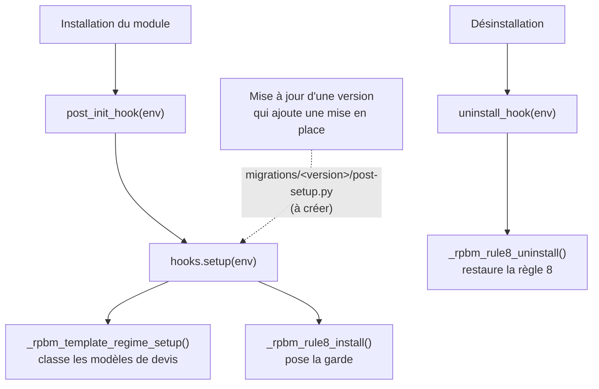

# Installation et déploiement

[RPBM Pricing](../../README.md) › [Documentation](../README.md) › [Manuel technique](README.md) › Installation et déploiement

Le module se développe en local sans Odoo (contrôles hors ligne seulement) et se valide sur un build Odoo.sh
de la branche `pre-prod`. Aucune installation locale d'Odoo n'est prévue.

## Mises en place

[`__init__.py`](../../__init__.py) exporte `post_init_hook` et `uninstall_hook`, déclarés dans le manifeste
(`__manifest__.py:24-25`). [`hooks.py:12-24`](../../hooks.py) :

- `setup(env)` appelle, dans l'ordre, `_rpbm_template_regime_setup()` puis `_rpbm_rule8_install()`.
  Les deux sont idempotentes.
- `post_init_hook` n'appelle que `setup`. Odoo ne le lance qu'à une **nouvelle installation**
  (`/root/git/odoo17/odoo/odoo/modules/loading.py:243-247`, condition `new_install`).
- `uninstall_hook` appelle `_rpbm_rule8_uninstall()`.

Il n'y a **pas de dossier `migrations/`**. Les migrations ne tournent pas à l'installation
(`odoo/modules/migration.py:152`, retour immédiat pour l'état `to install`). Une version qui ajouterait une
mise en place devra livrer `migrations/<version>/post-setup.py` qui rappelle `setup()`, pour les bases où le
module est déjà installé (voir [Conventions](conventions.md)).

### Journal attendu à l'installation

| Message | Sens |
|---|---|
| `rpbm_pricing: mise en place` | `setup` démarre |
| `rpbm_pricing: N modèle(s) de devis classé(s) sur M sans régime` | classement des modèles |
| `rpbm_pricing: garde de la règle 8 posée sur l'action 1510` | garde posée |
| `rpbm_pricing: valeur inattendue de l'action … garde non posée` | valeur de l'action différente de l'originale : la relire avant tout |
| `rpbm_pricing: action de la règle 8 introuvable, garde non posée` | pas d'automatisation « Tarif x glass » sur la base |

Si le module est déjà installé et que la garde manque, la poser par l'action serveur « RPBM : activer la garde
de la règle 8 » ([Garde de la règle 8](regle-8.md#actions-serveur)).

## Installer

Sur un build Odoo.sh de `pre-prod` (URL résolue par la skill `odoo-sh-build-connect`, jamais l'alias de
branche) :

1. *Applications › Mettre à jour la liste des applications*.
2. Installer « RPBM Pricing ». `rpbm_agent` doit être installé : c'est une dépendance.
3. Relire le journal (tableau ci-dessus).
4. Lancer les [tests](tests.md) dans le webshell.

Sur une base sans Studio (ou sans `base_automation`), le module s'installe : le classement des modèles de
devis se fait, la garde n'est pas posée et rien n'échoue.

## Mettre à jour

Incrémenter la version du manifeste (`17.0.AAMMJJ.N`) à chaque modification déployée. Sur Odoo.sh, un simple
`git push` sur `pre-prod` conserve la base et ne lance `-u` que sur les modules dont la version a changé
(environ une minute, constaté le 2026-10-13 sur le build `rpbm-pre-prod-39736343`). Les données `noupdate`
(paramètres, actions serveur) ne sont pas réécrites.

Une mise à jour ne rejoue ni le classement des modèles de devis ni la pose de la garde. Si une version en
ajoute un, elle passe par `migrations/<version>/post-setup.py`.

## Désinstaller

Odoo lance d'abord `uninstall_hook`, qui restaure la règle 8 d'origine (journal « retrait de la garde de la
règle 8 »), puis supprime les données du module (`odoo/modules/loading.py:552-567`).

Ce que supprime ensuite le mécanisme standard d'Odoo
(`/root/git/odoo17/odoo/odoo/addons/base/models/ir_model.py:2366-2395`, tout enregistrement qui porte un
identifiant externe du module) :

- les tables `rpbm_colisage*`, donc **tous les colisages et leurs DAU**, et les colonnes `rpbm_colisage_id`,
  `rpbm_transport_mode`, `rpbm_regime` (modèle de devis) et `rpbm_xglass_price` (ligne de facture) ajoutées aux modèles d'Odoo ;
- les six paramètres et les trois actions serveur du module, créés par des fichiers de données ;
- pas `rpbm_pricing.rule8_original_value`, écrit par code sans identifiant externe : il reste en base
  (déduit du code, non vérifié par un test).

Exporter les colisages avant de désinstaller. Rien dans le module ne les protège.

## Déploiement Odoo.sh : push et Branch Rebuild

| Action | Effet sur la base | Effet sur le module |
|---|---|---|
| `git push` sur `pre-prod` | base conservée avec toutes ses données | `-u` sur les modules dont la version change |
| « Branch Rebuild » du tableau de bord | base recréée depuis une copie de la production | `rpbm_agent` et `rpbm_pricing` désinstallés ; données de mise en place (articles, architecture stock, vues Studio) à refaire ; la variable `RPBM_PREPROD_DB` doit être mise à jour |

Un rebuild dure environ 25 minutes pour la remise en place complète, dont environ 21 minutes pour la phase
des coûts. Constaté le 2026-10-13 ; ne pas lancer de rebuild sans nécessité.

### Remise en place de la préprod après un rebuild

Les scripts sont dans [`Jobs/rpbm_agent_stock/`](../../../Jobs/rpbm_agent_stock/README.md). Séquence, d'après
son README :

1. `install_module.py --commit` : installe `rpbm_agent` (le script ne vise que ce module,
   `MODULE_NAME = "rpbm_agent"`).
2. `studio_views.py apply --commit` : vues Studio et champs natifs.
3. `Jobs/Gestion Stock/import_odoo.py <phase> --commit` : catalogue.
4. Modèles de devis et articles sans fournisseur (plan `Jobs/rpbm_agent_stock/plan-modeles-devis.md`).
5. `setup_stock_architecture.py <phase> --commit` : architecture stock.
6. `verify_structural.py` (lecture seule).

**Aucun de ces scripts n'installe `rpbm_pricing`.** Après l'étape 1, l'installer par l'interface (section
« Installer »). L'automatisation Studio « Tarif x glass » doit exister pour que la garde soit posée ; sinon
exécuter l'action « RPBM : activer la garde de la règle 8 » une fois la règle présente. Chaque script est en
simulation par défaut et n'écrit qu'avec `--commit`.

### Production

`rpbm_agent` et `rpbm_pricing` s'installent ensemble, seulement après IMP-1, DOC-10, IMP-0 et le lot WPA
(recopie Studio vers natif à l'installation de `rpbm_agent`). Le mode règle 8 reste le seul disponible ;
l'arrondi reste à 0 tant que Q-12 n'est pas tranché. Voir [Vue d'ensemble](vue-ensemble.md#différé).

Voir aussi : [Tests](tests.md) · [Jobs/rpbm_agent_stock](../../../Jobs/rpbm_agent_stock/README.md)

---
Précédent : [Données, paramètres et droits](parametres.md) · Suivant : [Tests](tests.md)
