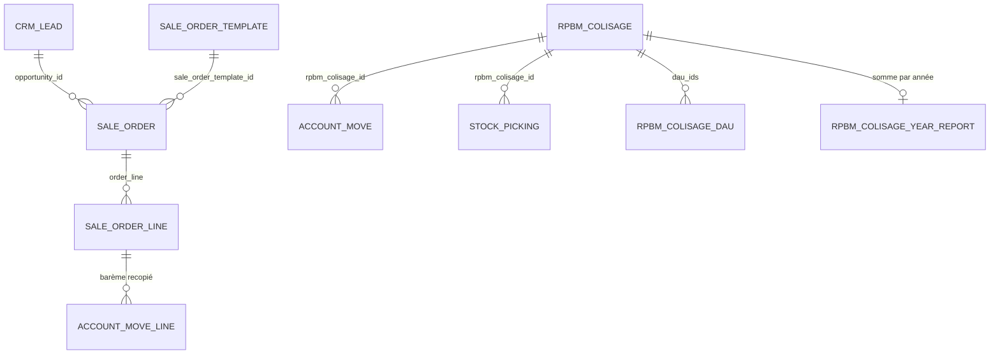

# Modèles et champs

[RPBM Pricing](../../README.md) › [Documentation](../README.md) › [Manuel technique](README.md) › Modèles et champs

Tous les champs du module ont un nom natif `rpbm_*`. Un nom `x_studio_*` n'apparaît que dans
[`models/legacy_fields.py`](../../models/legacy_fields.py). L'ordre d'import des modèles est dans
[`models/__init__.py`](../../models/__init__.py) : `rpbm_colisage` précède `rpbm_colisage_report`, car
`init()` de la vue SQL suit l'ordre d'import (`models/__init__.py:8-10`).

## Régime

| Modèle | Champ | Type | Détail | Source |
|---|---|---|---|---|
| `sale.order` | `rpbm_regime` | Selection (Assurance, Hors assurance) « Régime du dossier » | calculé, non stocké ; dépend de `opportunity_id` ; vide sans opportunité, « Assurance » si l'opportunité porte un assureur, sinon « Hors assurance » ; lu en `sudo` | [`models/sale_order_regime.py:10,21-23`](../../models/sale_order_regime.py) |
| `sale.order` | `rpbm_pricing_warning` | Text « Avertissement tarifaire » | calculé, non stocké ; messages joints par un saut de ligne | [`models/sale_order_regime.py:25-33`](../../models/sale_order_regime.py) |
| `sale.order.template` | `rpbm_regime` | Selection « Régime » | stocké, modifiable ; simple relais, le régime qui fait foi est celui du dossier | [`models/sale_order_template.py:15`](../../models/sale_order_template.py) |

Le régime se déduit du champ Studio « Assurance (Simplifié) » de `crm.lead`
(`x_studio_field_ZiY2J`, [`models/legacy_fields.py:8`](../../models/legacy_fields.py)). Sans ce champ
(base neuve sans Studio), tout dossier avec opportunité est « Hors assurance ».

Les règles pures sont dans [`lib/regime.py`](../../lib/regime.py) :

- `dossier_regime(has_opportunity, has_insurer)` (`lib/regime.py:18-22`) ;
- `template_regime(normalized_name)` (`lib/regime.py:25-32`) : égalité avec cinq noms normalisés
  (`pare brise v`, `lunette arriere`, `glace mobile`, `glace fixe`, `reglage adas (assurance)`) donne
  Assurance, un nom contenant `hors assurance` donne Hors assurance, sinon rien ;
- `warnings(...)` (`lib/regime.py:35-44`) : deux messages possibles.

| Message | Condition |
|---|---|
| « Le modèle de devis est « X », le dossier est « Y ». » | modèle et dossier connus et différents (P-05) |
| « Main-d'œuvre X'Glass proposée sur un dossier hors assurance : vérifiez la grille hors assurance. » | dossier hors assurance et une ligne porte `rpbm_labor_operation_key` (P-16) |

`sale.order.template._rpbm_template_regime_setup()` ([`models/sale_order_template.py:18-29`](../../models/sale_order_template.py))
classe les modèles sans régime, archivés compris, d'après leur nom normalisé. Une valeur déjà posée est
respectée ; la méthode est idempotente et renvoie le nombre de modèles classés.

## Ligne de devis et de facture

| Modèle | Champ | Type | Détail | Source |
|---|---|---|---|---|
| `sale.order.line` | `rpbm_rule8_price` | Float « Prix de la règle 8 », précision `Product Price` | calculé, non stocké ; **ne pas renommer** : l'action 1510 le teste par `'rpbm_rule8_price' in record._fields` | [`models/sale_order_line_rule8.py:41-42`](../../models/sale_order_line_rule8.py) |
| `account.move.line` | `rpbm_xglass_price` | Float « Barème X'Glass » | aucune vue ni impression ne l'affiche (IMP-10) | [`models/account_move_line.py:8`](../../models/account_move_line.py) |

`rpbm_xglass_price` (Prix X'Glass) et `rpbm_labor_operation_key` de `sale.order.line` appartiennent à
`rpbm_agent`, pas à ce module. Le calcul de `rpbm_rule8_price` est détaillé dans la
[garde de la règle 8](regle-8.md#le-prix-de-la-règle-8).

## Achat et réception

| Modèle | Champ | Type | Détail | Source |
|---|---|---|---|---|
| `purchase.order` | `rpbm_transport_mode` | Selection (Avion, Bateau) « Mode » | défaut Avion, requis, suivi ; posé à la main par l'acheteur | [`models/purchase_order.py:8-9`](../../models/purchase_order.py) |
| `account.move` | `rpbm_colisage_id` | Many2one `rpbm.colisage` « Colisage VSF » | groupe `purchase.group_purchase_user`, `copy=False`, indexé, suivi ; domaine : partenaire commercial de la facture | [`models/rpbm_colisage.py:182-184`](../../models/rpbm_colisage.py) |
| `stock.picking` | `rpbm_colisage_id` | Many2one `rpbm.colisage` « Colisage VSF » | mêmes réserves, sans suivi | [`models/rpbm_colisage.py:190`](../../models/rpbm_colisage.py) |

## Colisage

| Modèle | Rôle | Source |
|---|---|---|
| `rpbm.colisage` | un envoi VSF, identifié par le numéro de sa facture MARCH ; hérite de `mail.thread` | [`models/rpbm_colisage.py:18-46`](../../models/rpbm_colisage.py) |
| `rpbm.colisage.dau` | DAU d'un colisage : N° DAU, date, octroi de mer, TVA pour information | [`models/rpbm_colisage.py:165-176`](../../models/rpbm_colisage.py) |
| `rpbm.colisage.year.report` | vue SQL, une ligne par année, colisages retenus seulement | [`models/rpbm_colisage_report.py:4-36`](../../models/rpbm_colisage_report.py) |

Champs de `rpbm.colisage` :

| Champ | Type | Détail |
|---|---|---|
| `name` « N° MARCH » | Char, requis, suivi | unique : « Ce numéro de MARCH a déjà son colisage. » |
| `partner_id` « Fournisseur » | Many2one `res.partner` | défaut : partenaire VSF de `rpbm_agent` ; vide, avec un avertissement au journal, si `get_vsf_partner_id` lève une `UserError` |
| `company_id` « Société » | Many2one, requis | défaut : société courante |
| `rpbm_mode` « Mode » | Selection (Avion, Bateau), requis, suivi | défaut Avion |
| `date` « Date » | Date | |
| `year` « Année » | Integer, stocké | calculé depuis la date, 0 sans date |
| `march_move_id` « Facture MARCH » | Many2one `account.move`, suivi | unique : « Cette facture MARCH a déjà son colisage. » |
| `move_ids`, `picking_ids`, `dau_ids` | One2many | factures et avoirs, réceptions, DAU |
| `amount_pieces`, `amount_fees` | Monetary, stockés, calculés | devise de la société (raccourci assumé) |
| `coefficient` | Float (16, 4), stocké, calculé | `group_operator=False` : jamais additionné en regroupement (P-41) |
| `is_retained` « Retenu » | Boolean, stocké, calculé | pièces et frais strictement au-dessus des seuils |

`rpbm.colisage.dau` : `colisage_id` requis, `ondelete="cascade"`. `rpbm.colisage.year.report` : `_auto = False`,
liste seule, sans pivot, sans création, édition ni suppression. Le calcul des montants est détaillé dans
[Colisage VSF](colisage.md#montants-et-coefficient).

Voir aussi : [Données, paramètres et droits](parametres.md)

---
Précédent : [Vue d'ensemble](vue-ensemble.md) · Suivant : [Surcharges](surcharges.md)
