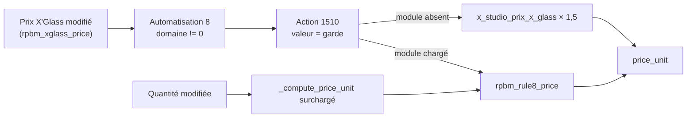

# Garde de la règle 8

[RPBM Pricing](../../README.md) › [Documentation](../README.md) › [Manuel technique](README.md) › Garde de la règle 8

Lot IMP-2. La règle 8 est l'automatisation Studio « Tarif x glass » (`base.automation` 8 en préprod). Quand
le Prix X'Glass d'une ligne de devis change et n'est pas nul, son action serveur (`ir.actions.server` 1510, du
même nom) écrit `price_unit = Prix X'Glass × 1,5`. Le module ne remplace pas cette automatisation : il garde
son action, sans toucher au domaine ni au déclencheur.

Code : [`models/sale_order_line_rule8.py`](../../models/sale_order_line_rule8.py). Constantes Studio :
[`models/legacy_fields.py`](../../models/legacy_fields.py). Données : [`data/rule8_data.xml`](../../data/rule8_data.xml).
Tests : [`tests/test_rule8.py`](../../tests/test_rule8.py).



## La garde

La valeur de l'action passe de `record.x_studio_prix_x_glass*1.5` à :

```python
record.rpbm_rule8_price if 'rpbm_rule8_price' in record._fields else record.x_studio_prix_x_glass*1.5
```

Les deux valeurs sont les constantes `RULE8_ORIGINAL_VALUE` et `RULE8_GUARD_VALUE`
([`models/legacy_fields.py:15-20`](../../models/legacy_fields.py)).

### `safe_eval`

L'action `object_write` évalue sa valeur par `safe_eval`. Celui-ci ne refuse que les noms contenant `__` et
quelques attributs de frame (`/root/git/odoo17/odoo/odoo/tools/safe_eval.py:200-221`,
`assert_no_dunder_name`, `_UNSAFE_ATTRIBUTES` en `:53`). `_fields`, `in` et l'expression conditionnelle
passent ; l'expression a été vérifiée en l'évaluant avec le `safe_eval` d'Odoo 17.

### Réversibilité

- **Sans désinstallation.** Si le code du module disparaît (retour à un commit antérieur, module non chargé),
  `rpbm_rule8_price` sort de `_fields` et l'action retombe sur la formule d'origine. Aucune ligne ne plante.
- **Par action serveur.** « RPBM : restaurer la règle 8 d'origine » réécrit la valeur d'origine ;
  « RPBM : activer la garde de la règle 8 » la repose.
- **À la désinstallation.** `uninstall_hook` appelle `_rpbm_rule8_uninstall()`.

L'enregistrement Studio est `noupdate` : la garde est posée par code, jamais par un fichier XML.

## Le prix de la règle 8

`sale.order.line.rpbm_rule8_price` (calculé, non stocké) vaut `_rpbm_rule8_value()`, à défaut `price_unit`
(l'action réécrit alors le prix tel quel), [`models/sale_order_line_rule8.py:72-77`](../../models/sale_order_line_rule8.py).

`_rpbm_rule8_value()` ([`:55-70`](../../models/sale_order_line_rule8.py)) renvoie `None`, et le prix reste
inchangé, dans ces cas :

- ligne sans article, ou barème (`rpbm_xglass_price`) nul ;
- article de type service ;
- article d'une catégorie enfant de 19 « Consommable », 20 « Film solaire » ou 22 « Services » (P-09),
  retrouvées par les xmlid `__import__.rpbm_categ_consommable`, `…film_solaire`, `…services`
  (`:26-30`, `_rpbm_rule8_excluded_categories` en `:44-53`) ; un xmlid absent est ignoré ;
- filtre de régime actif (`rule8_insurance_only = 1`) et dossier explicitement hors assurance (opportunité
  sans assureur). Un devis sans opportunité reste majoré.

Sinon : barème × `insurance_coefficient`, arrondi au pas `price_rounding` par `float_round` seulement s'il est
positif. Avec les valeurs par défaut, 341,87 donne 512,805 (précision `Product Price`), comme la règle
d'origine.

## Recalcul à la quantité

La surcharge de `_compute_price_unit` est décrite dans [Surcharges](surcharges.md#saleorderline_compute_price_unit).
Elle traite à part les lignes où la règle 8 gardée s'applique : automatisation active, action égale à la
garde, barème non nul, article non exclu, ligne non facturée, hors lignes d'option de `sale_management`.

## Retrouver l'action

`_rpbm_rule8_action()` ([`:79-95`](../../models/sale_order_line_rule8.py)) cherche l'action par xmlid
(`RULE8_ACTION_XMLID`), sinon la seule action `object_write` sur `price_unit` de `sale.order.line` dont la
valeur est l'originale ou la garde. Plusieurs candidates : aucune n'est retenue et un avertissement est
journalisé. `_rpbm_rule8_automation()` fait de même pour l'automatisation (`:97-114`) et renvoie `False` sans
`base_automation`.

## Mise en place et retrait

`_rpbm_rule8_install()` ([`:123-140`](../../models/sale_order_line_rule8.py)) :

1. action introuvable : journal, renvoie `False` ;
2. déjà gardée : renvoie `True` sans rien écrire ;
3. valeur différente de l'originale, espaces ignorés : avertissement, rien n'est écrit, `False` ;
4. sinon, sauvegarde dans `rpbm_pricing.rule8_original_value`, puis écrit la garde en conservant le nom de
   l'action (`base_automation` le recalculerait sinon depuis la valeur).

`_rpbm_rule8_uninstall()` (`:142-151`) : si l'action porte la garde, réécrit la valeur sauvegardée, à défaut
l'originale.

## Actions serveur

Deux actions, réservées à `base.group_system` ([`data/rule8_data.xml:19-42`](../../data/rule8_data.xml)),
accessibles par *Paramètres › Technique › Actions serveur*, bouton « Exécuter » (libellé du bouton d'Odoo). Le
modèle `ir.actions.server` est choisi à dessein : en Odoo 17, c'est lui qui fait afficher le bouton dans le
formulaire.

| Action | Appelle | Notification |
|---|---|---|
| RPBM : activer la garde de la règle 8 | `_rpbm_rule8_install()` | « Garde de la règle 8 en place. » ou « Garde non posée : action introuvable ou valeur inattendue (voir le journal). » |
| RPBM : restaurer la règle 8 d'origine | `_rpbm_rule8_uninstall()` | « Règle 8 d'origine restaurée. » ou « Rien à restaurer : l'action ne porte pas la garde. » |

L'aller-retour « restaurer » puis « activer » a été vérifié en recette le 2026-10-13.

## Tests

[`tests/test_rule8.py`](../../tests/test_rule8.py), 9 tests : installation et retrait, valeur d'origine avec
espaces, valeur inattendue jamais écrasée, prix, service, catégorie exclue, filtre de régime, quantité et
barème de bout en bout, ligne facturée conservée. Les tests de bout en bout sautent si l'automatisation
réelle est absente, inactive ou porte une valeur inattendue. Voir [Tests](tests.md).

Voir aussi : [Surcharges](surcharges.md) · [Données, paramètres et droits](parametres.md)

---
Précédent : [Surcharges](surcharges.md) · Suivant : [Colisage VSF](colisage.md)
