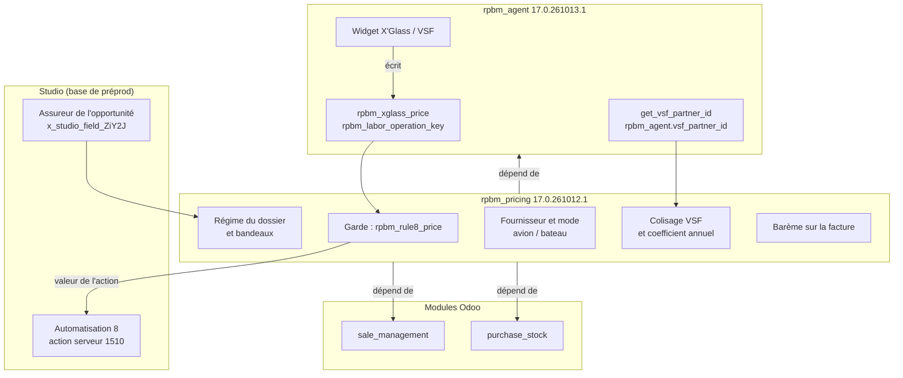

# Vue d'ensemble

[RPBM Pricing](../../README.md) › [Documentation](../README.md) › [Manuel technique](README.md) › Vue d'ensemble

`rpbm_pricing` est le socle tarifaire de RPBM. Il ne remplace rien : il garde, complète et mesure ce que
`rpbm_agent` et Odoo Studio font déjà. Il ne contient aucune règle de prix nouvelle tant que les
décisions du client ne sont pas prises.

## Place dans l'architecture

Dépendances déclarées : [`__manifest__.py:14`](../../__manifest__.py) donne `rpbm_agent`, `sale_management` et
`purchase_stock`. Studio et `base_automation` ne sont pas déclarés : le module s'installe sur une base
sans eux et chaque accès est gardé (`'base.automation' not in env` dans
[`models/sale_order_line_rule8.py:100`](../../models/sale_order_line_rule8.py), `name in model._fields` dans
[`models/legacy_fields.py:23-25`](../../models/legacy_fields.py)).

Ce que `rpbm_agent` fournit au module, sans que `rpbm_pricing` le redéfinisse :

| Élément de `rpbm_agent` | Usage dans `rpbm_pricing` | Source |
|---|---|---|
| `sale.order.line.rpbm_xglass_price` | barème lu par la règle 8, recopié sur la facture | [`rpbm_agent/models/sale_order.py:155`](../../../rpbm_agent/models/sale_order.py) |
| `sale.order.line.rpbm_labor_operation_key` | détection d'une main-d'œuvre X'Glass pour le bandeau hors assurance | [`rpbm_agent/models/sale_order.py:157`](../../../rpbm_agent/models/sale_order.py) |
| `get_vsf_partner_id`, `VSF_PARTNER_PARAM` | partenaire VSF du colisage et de la reprise | [`rpbm_agent/controllers/vsf_config.py:8`](../../../rpbm_agent/controllers/vsf_config.py) |
| `normalize` | classement des modèles de devis par leur nom | [`rpbm_agent/models/legacy_fields.py`](../../../rpbm_agent/models/legacy_fields.py) |

La synchronisation Studio/natif de `rpbm_agent` (version `17.0.261013.1`) laisse désormais une valeur
Studio saisie l'emporter sur un natif vide, que le formulaire envoie à 0 par défaut. Cela corrige la
perte du Prix X'Glass saisi à la main sur une ligne neuve, donc l'entrée de la règle 8.

## Lots livrés (itération 1)

Une seule version de manifeste couvre toute l'itération. Les lots sont ceux de la feuille de route
(`docs/architecture/feuille-de-route.md`, local, non suivi par Git) et du plan
`.paradigme/audits/rpbm_pricing/plan-iteration-1.md` (local).

| Lot | Contenu | Page |
|---|---|---|
| Socle régime (P-05, P-16) | régime du dossier calculé, relais du modèle de devis, bandeau de divergence, bandeau « main-d'œuvre X'Glass hors assurance » | [Modèles](modeles.md#régime) |
| IMP-2 | garde de la règle 8 : exclusions, coefficient et arrondi en paramètres, quantité sans effet sur le prix, retour arrière | [Règle 8](regle-8.md) |
| IMP-6 (code) | le client livré n'est plus candidat fournisseur (P-36) | [Surcharges](surcharges.md#stockrule_get_partner_id) |
| IMP-8 (partie) | mode avion ou bateau sur l'achat, brouillon bateau exclu du regroupement (P-47) | [Surcharges](surcharges.md#stockrule_make_po_get_domain) |
| IMP-7 | colisage VSF, DAU, coefficient, colisage retenu, coefficient annuel, reprise 2025-2026 | [Colisage VSF](colisage.md) |
| IMP-10 (partie) | barème recopié sur la ligne de facture, net et remise fournisseur jamais imprimés (P-24) | [Surcharges](surcharges.md#saleorderline_prepare_invoice_line) |

Le module fonctionne en mode « règle 8 » seulement. C'est le seul mode possible en production tant que le
widget n'écrit pas le Prix XGlass HT (IMP-1) ; il écrit le prix fournisseur VSF brut avec la remise de 20 %
depuis `rpbm_agent` 17.0.261022.1 (IMP-3 côté widget).

## Différé

Rien de ce tableau n'est dans le code.

| Sujet | Attend |
|---|---|
| filtre de date et arrondi effectif de la règle 8 | Q-12 |
| activation du filtre de régime de la règle 8 (`rule8_insurance_only`) | validation du client : sinon une ligne hors assurance garde le `list_price` |
| IMP-3 côté prix | tarif VSF au prix public + 20 % depuis 17.0.261022.1 (176 lignes encore au net, historisées à la prochaine synchronisation) |
| IMP-4 : listes de prix par régime, bascule | IMP-1, IMP-3, Q-04, Q-08, Q-09, Q-12, Q-13 |
| IMP-5 : main-d'œuvre et pose | Q-14 à Q-17, E-02 |
| IMP-8 (reste) : fournisseur prévu, position fiscale, achat local, points de commande, droits | Q-20, E-01, Q-22, Q-21, Q-23 |
| IMP-9 : coût et frais affectés | IMP-7, IMP-8, Q-07, Q-19, E-03, E-04 |
| IMP-10 (reste) : avoirs typés, mise en demeure, franchise | Q-09, Q-10, Q-11, E-02 |
| IMP-11 : option FFC | choix de l'option (Q-06, Q-07, Q-12, E-05, F-01 à F-03) |
| rattachement systématique des réceptions au colisage | Q-19 (P-42) |
| fusion des fournisseurs | Q-24, hors module |

**Prérequis de la production** (lot WPA et autres lots de `rpbm_agent`) : `rpbm_agent` doit recopier les
champs Studio vers ses champs natifs à son installation, sinon `rpbm_xglass_price` reste nul sur l'historique ;
IMP-1, DOC-10 et IMP-0 doivent être livrés ; le défaut du widget
([`rpbm_agent/static/src/agent_widget_dialog_sale_order.js:147`](../../../rpbm_agent/static/src/agent_widget_dialog_sale_order.js))
doit être corrigé.

## Contraintes retenues pour l'itération 2

Futur uniquement, rien de cela n'est livré. Plan, section 11 :

- bascule refusée tant que `rpbm_pricing.switch_prerequisites_ok` n'est pas à 1 (clé non créée) ;
- devis antérieurs gelés ; aucune dépendance ajoutée à `_compute_pricelist_id` ;
- contrôles P-02 et P-12 sur le régime du dossier ;
- remise nominale lue dans `rpbm_agent.vsf_discount` (A-13) ;
- fournisseur prévu : même partenaire dans `_get_partner_id` et à la confirmation ;
- assistant d'avoirs : article paramétré obligatoire.

Voir aussi : [Documentation de `rpbm_agent`](../../../rpbm_agent/docs/README.md)

---
Précédent : [Manuel technique](README.md) · Suivant : [Modèles et champs](modeles.md)
