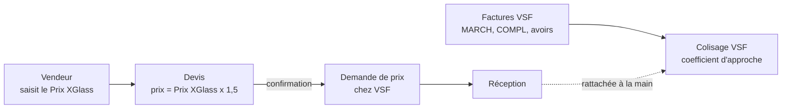

# Manuel utilisateur — RPBM Pricing

[RPBM Pricing](../../README.md) › [Documentation](../README.md) › Manuel utilisateur

Ce manuel s'adresse aux équipes de RPBM. Il décrit ce que le module `rpbm_pricing` change à l'écran, tâche
par tâche. Il correspond à `rpbm_pricing` 17.0.261012.1 et `rpbm_agent` 17.0.261013.1. Les libellés sont ceux
de l'interface en français.

## Quelle page lire

| Vous êtes | Page | Vous y trouvez |
|---|---|---|
| Vendeur | [Vendeurs](vendeurs.md) | Régime du dossier, bandeau d'avertissement, prix d'assurance, quantité, Prix XGlass saisi, pose à domicile |
| Acheteur (Margot, Yan, Mickaël) | [Acheteurs](acheteurs.md) | Demande de prix chez VSF, mode Avion ou Bateau, brouillon bateau |
| Achats | [Colisages VSF](colisages-vsf.md) | Reprise de l'historique, factures MARCH et COMPL, avoirs, DAU, coefficient annuel |
| Administrateur | [Administrateur](administrateur.md) | Paramètres, activer ou restaurer la garde de la règle 8 |
| Tout le monde | [Questions fréquentes](faq.md) | « Pourquoi ce prix ? », « Que faire si… ? » |
| Tout le monde | [Pas encore disponible](pas-encore.md) | Ce que le module ne fait pas encore |

## Le module en une image

Vendeurs : vous travaillez à gauche (devis, bandeau, pose). Achats : à droite. La comptabilité n'a pas encore de
droit propre : voir [Pas encore disponible](pas-encore.md).

## Qui voit quoi

| Profil | Voit | Ne voit pas |
|---|---|---|
| Vendeur | Régime du dossier, bandeau, prix des lignes, achat lié depuis la réception | Menu Colisages VSF, champ Colisage VSF, montants des colisages |
| Achats › Responsable (Yan, Mickaël) | Tout le menu *Achats › Colisages VSF*, suppression, reprise de l'historique | — |
| Administrateur (Margot, Romain) | Idem, plus les actions de la règle 8 et les paramètres | — |
| Comptable | Rien de propre au module pour l'instant | Voir [Colisages VSF](colisages-vsf.md#qui-peut-le-faire) |

Les droits viennent de [`security/ir.model.access.csv`](../../security/ir.model.access.csv). Le rôle de
chacun dans les achats est décrit dans le dossier `docs/` local du dépôt (non suivi par Git).

Voir aussi : [Manuel technique](../technique/README.md) · [Données, paramètres et droits](../technique/parametres.md)

---
Précédent : [Documentation du module](../README.md) · Suivant : [Vendeurs](vendeurs.md)
