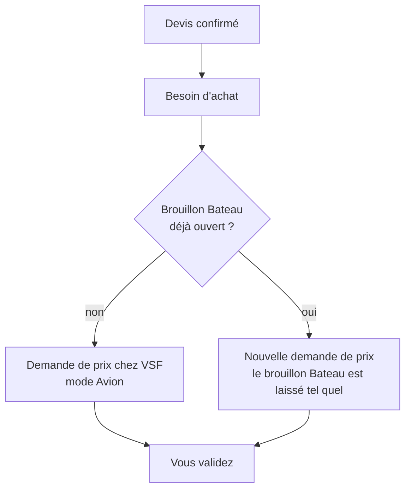

# Acheteurs

[RPBM Pricing](../../README.md) › [Documentation](../README.md) › [Manuel utilisateur](README.md) › Acheteurs

Pour les achats : Margot, Yan et Mickaël (Margot est aussi administratrice). Yan et Mickaël valident les achats. Les vendeurs voient les achats mais ne les
valident pas.

## La demande de prix va chez VSF, pas chez le client

À la confirmation d'un devis, Odoo crée la demande de prix chez le premier fournisseur de la fiche article
(onglet **Achats**, ligne du haut ; pour VSF, la ligne en séquence 1). Le client livré n'est jamais choisi
comme fournisseur.

Si Odoo affiche « no matching vendor price » (message anglais d'Odoo), aucune ligne fournisseur ne convient.
Sur la fiche article, vérifiez le fournisseur, le prix, la quantité minimale et les dates de validité.

## Le mode Avion ou Bateau

Sur une demande de prix ou un bon de commande, le champ **Mode** se trouve juste après **Référence
fournisseur**. Il vaut **Avion** par défaut. Il est aussi en colonne dans les listes des demandes de prix et
des bons de commande. La colonne **Mode** est affichée par défaut ; si vous ne la voyez pas, ouvrez le menu des
colonnes (icône à droite de l'en-tête) et cochez **Mode**.

Vous le choisissez à la main. Son changement est suivi dans le fil de la commande.

## Le brouillon bateau

Quand vous voulez regrouper plusieurs pièces dans un envoi par bateau :

1. *Achats › Commandes › Demandes de prix* : ouvrez celle de VSF en brouillon, ou créez-en une avec **Nouveau**.
2. Passez **Mode** à **Bateau**.
3. Ajoutez vos pièces avec **Ajouter un produit**.
4. Envoyez ou confirmez quand le colis est prêt.

Une demande de prix en brouillon **Bateau** ne reçoit plus les besoins automatiques. Un nouveau devis confirmé
crée une autre demande de prix, en mode Avion : **surveillez les deux** pour le même fournisseur. Cela évite
de mélanger un envoi par avion urgent avec la caisse du bateau.

Une demande de prix en mode Avion continue de regrouper les besoins automatiques, comme avant.

## Ce que le module ne fait pas encore

- Il ne choisit pas le mode à votre place.
- Il ne rattache pas les réceptions à un colisage : voir [Colisages VSF](colisages-vsf.md).
- Le prix fournisseur enregistré est encore un net inexact : voir [Pas encore disponible](pas-encore.md).

Voir aussi : [Colisage VSF](../technique/colisage.md)

---
Précédent : [Vendeurs](vendeurs.md) · Suivant : [Colisages VSF](colisages-vsf.md)
