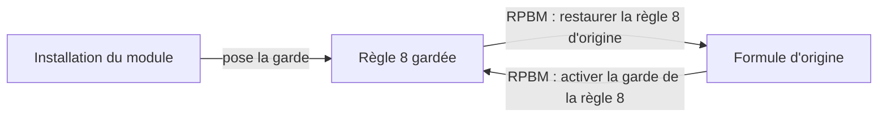

# Administrateur

[RPBM Pricing](../../README.md) › [Documentation](../README.md) › [Manuel utilisateur](README.md) › Administrateur

Pour Margot et Romain (groupe administrateur). Les menus **Technique** ne s'affichent qu'en mode
développeur : activez-le d'abord (*Paramètres › Activer le mode développeur*).

## La garde de la règle 8

La règle 8 est le calcul automatique du prix d'une ligne (Prix XGlass × 1,5). Le module la remplace par un calcul
plus complet (services exclus, quantité). Ne touchez à ces deux actions que si le prix des lignes pose problème :
restaurez la règle 8 d'origine pour revenir au calcul simple, puis informez le support.

La règle 8 est l'automatisation Studio « Tarif x glass », qui calcule le prix d'une ligne à partir du Prix
XGlass. Le module la garde : elle appelle son calcul (exclusions, quantité) au lieu de la formule
d'origine « Prix XGlass × 1,5 ». L'installation du module pose la garde. Elle reste posée tant qu'on ne la
restaure pas.

Sans le code du module, l'action retombe seule sur la formule d'origine : aucune ligne ne plante.

### Restaurer la règle 8 d'origine

1. *Paramètres › Technique › Actions › Actions serveur*.
2. Ouvrez **RPBM : restaurer la règle 8 d'origine**.
3. Cliquez sur **Exécuter**.

Message de succès : « Règle 8 d'origine restaurée. » Message d'avertissement : « Rien à restaurer : l'action
ne porte pas la garde. »

### Activer la garde de la règle 8

Même chemin, avec l'action **RPBM : activer la garde de la règle 8**.

Message de succès : « Garde de la règle 8 en place. » Message d'avertissement : « Garde non posée : action
introuvable ou valeur inattendue (voir le journal). » Dans ce cas, l'action a été modifiée à la main : le
module n'écrit rien. Le détail est dans le journal du serveur.

Les deux actions sont réservées aux administrateurs. L'aller-retour a été vérifié en recette le
13 octobre 2026.

## Les paramètres

*Paramètres › Technique › Paramètres › Paramètres système*, rechercher `rpbm_pricing`. Une valeur modifiée n'est jamais
écrasée par une mise à jour du module. Une valeur illisible est remplacée par le défaut, sans erreur.

| Clé | Défaut | Valeurs possibles | À quoi ça sert |
|---|---|---|---|
| `rpbm_pricing.insurance_coefficient` | 1.5 | un nombre (1.5 ou 1,5) | Coefficient du prix d'assurance |
| `rpbm_pricing.price_rounding` | 0 | 0 (pas d'arrondi) ou 0.01 (centime) | Arrondi du prix |
| `rpbm_pricing.rule8_insurance_only` | 0 | 1 (hors assurance au prix de la fiche article) ou 0 (même prix que l'assurance) | Majoration des dossiers hors assurance |
| `rpbm_pricing.colisage_min_pieces` | 500 | un montant (devise de la société) | Seuil des pièces d'un colisage retenu |
| `rpbm_pricing.colisage_min_fees` | 629 | un montant (devise de la société) | Seuil des frais d'un colisage retenu |
| `rpbm_pricing.colisage_boat_marchs` | 751102,795714,797088,855133,916930 | numéros de MARCH séparés par des virgules | MARCH comptées en bateau, en plus de « MARITIME » et « BATEAU » |

Ne touchez pas à `rpbm_pricing.rule8_original_value` : c'est la sauvegarde de la formule d'origine.

Précautions :

- **Coefficient et arrondi** : ils s'appliquent au prochain calcul d'une ligne. Les devis existants ne sont
  pas recalculés.
- **`rule8_insurance_only` à 1** : le prix des dossiers hors assurance change (retour au prix de la fiche
  article). À faire valider par le client avant.
- **Seuils et liste bateau** : après modification, lancez *Achats › Colisages VSF › Reprendre l'historique*
  pour recalculer.
- Les décimales avec virgule sont acceptées. Un booléen s'écrit 1, 0, oui, non, vrai ou faux.

## Désinstaller

La désinstallation restaure la règle 8 d'origine. Elle supprime aussi tous les colisages et leurs DAU et les six paramètres du module ; seule la clé `rpbm_pricing.rule8_original_value` reste. Exportez les colisages avant de désinstaller. Le détail est dans [Installation](../technique/installation.md).

Voir aussi : [Garde de la règle 8](../technique/regle-8.md) · [Données, paramètres et droits](../technique/parametres.md)

---
Précédent : [Colisages VSF](colisages-vsf.md) · Suivant : [Questions fréquentes](faq.md)
