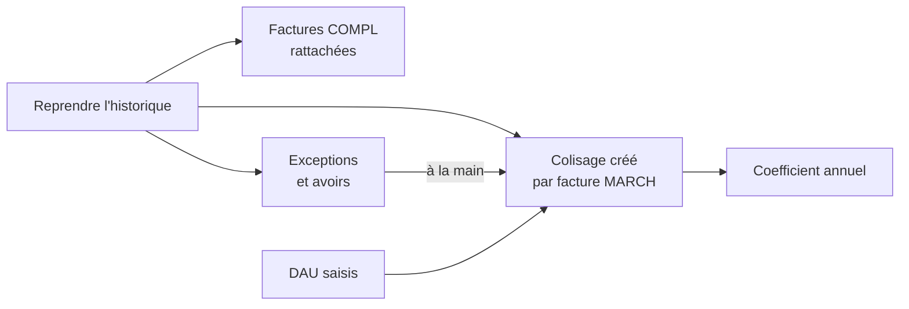

# Colisages VSF

[RPBM Pricing](../../README.md) › [Documentation](../README.md) › [Manuel utilisateur](README.md) › Colisages VSF

Un colisage est un envoi VSF, identifié par le numéro de sa facture **MARCH**. Il rassemble la MARCH, les
**COMPL** (transport, octroi de mer), les avoirs, les **DAU** et les réceptions. Il calcule le **coefficient**
d'approche. Le menu est *Achats › Colisages VSF*.

| Mot | Sens |
|---|---|
| MARCH | facture VSF de la marchandise (les pièces) |
| COMPL | facture complémentaire de VSF (transport, octroi de mer) |
| DAU | document administratif unique de douane |
| Octroi de mer | taxe locale d'importation, comptée dans les frais |
| Coefficient d'approche | (pièces + frais) / pièces |
| Comptabilisée | facture au statut Comptabilisé (validée) |

*À faire confirmer par Yan avant diffusion.*

## Qui peut le faire

| Action | Groupe Odoo requis |
|---|---|
| Voir le menu, créer ou modifier un colisage, rattacher une facture | Achats › Utilisateur |
| Supprimer un colisage ou un DAU, lancer *Reprendre l'historique* | Achats › Responsable |

Pour obtenir un droit, demandez à un administrateur de cocher le groupe dans votre fiche utilisateur. Aujourd'hui,
Yan et Mickaël sont responsables des achats ; Margot et Romain sont administrateurs.

- **Comptabilité** : le module ne donne pas de droit propre au comptable pour l'instant (ni menu, ni champ
  **Colisage VSF**). Le travail ci-dessous est donc fait par les achats. L'accès comptable est à confirmer
  avec le client.
- **Vendeurs** : aucun accès aux colisages ni à leurs montants.

## Reprendre l'historique

Cliquez sur *Achats › Colisages VSF › Reprendre l'historique*. Aucune fenêtre ne s'ouvre : l'import démarre et
une notification résume le résultat. Il lit les factures et avoirs fournisseur **comptabilisés** de
VSF depuis le 1er janvier 2025 et en déduit les colisages.

| Référence de la facture | Ce qui se passe |
|---|---|
| « NNNNNN - MARCH… » (par exemple « 941797 - MARCH ») | le colisage est créé (ou retrouvé par son numéro) et la facture rattachée |
| « NNNNNN - COMPL… » | rattachée au colisage dont le numéro apparaît après « DU » dans un libellé (par exemple « … DU 941797 ») |
| « NNNNNN - PACK VIN » | ignorée |
| avoir | comptée « à rattacher à la main » |
| autre | signalée en exception |

Le **mode** d'un colisage est Bateau si son numéro est dans la liste des MARCH bateau, ou si la référence ou
un libellé contient « MARITIME » ou « BATEAU ». Sinon, Avion.

Une notification s'affiche : « N colisage(s) créé(s), N facture(s) rattachée(s), N avoir(s) à rattacher à la
main. » Si des factures sont en exception, elle les liste et reste affichée : recopiez leurs références avant de la fermer.

La reprise peut être relancée sans risque : une facture déjà rattachée n'est jamais touchée, la seconde
exécution ne change rien. Elle recalcule tous les colisages. Relancez-la après toute modification des seuils ou
de la liste bateau ([Administrateur](administrateur.md)).

Exceptions habituelles : une COMPL qui cite sa MARCH sans « DU » ou avec un numéro erroné, et les COMPL de
janvier 2025 qui visent une MARCH de 2024.

Exemple de la reprise faite sur la préproduction le 13 octobre 2026 : 97 colisages, 185 factures rattachées,
4 avoirs à rattacher à la main.

## Rattacher une facture ou un avoir à la main

1. Ouvrez la facture (*Comptabilité ou Achats › Fournisseurs › Factures*) ou l'avoir (*… › Avoirs*).
2. Dans l'en-tête, à droite, sous **Compte bancaire**, choisissez le **Colisage VSF** (tapez le numéro MARCH).
3. Enregistrez.

Le champ n'est visible que des achats, sur une facture ou un avoir fournisseur. Pour lister ce qui reste, dans la
liste, ouvrez les filtres et cochez **Facture fournisseur sans colisage**.

Un **avoir** se déduit des montants du colisage. Les quatre avoirs de la reprise sont à rattacher ainsi.
Tant qu'ils ne le sont pas, les coefficients annuels sont faux.

Seules les factures **comptabilisées** comptent dans les montants.

## Créer un colisage ou le corriger

*Achats › Colisages VSF › Colisages VSF*, puis **Nouveau**.

| Champ | Contenu |
|---|---|
| N° MARCH | numéro de la facture MARCH, par exemple 941797 ; unique |
| Fournisseur | VSF, proposé par défaut |
| Mode | Avion ou Bateau |
| Date | date de l'envoi |
| Facture MARCH | la facture fournisseur correspondante ; une seule par colisage |

Les montants **Pièces**, **Frais**, **Coefficient** et **Retenu** (case à cocher en lecture seule), dans la colonne
de droite, se calculent seuls. Les onglets **Factures et avoirs** et **Réceptions** sont en lecture seule : le
rattachement se fait depuis la facture ou la réception. Un message vous
avertit si le N° MARCH ou la facture MARCH a déjà son colisage.

## Les DAU

Dans l'onglet **DAU** du colisage, ajoutez une ligne par DAU : **N° DAU**, **Date**, **Octroi de mer**,
**TVA (information)**. L'octroi de mer est un frais d'approche. La TVA d'importation est autoliquidée : elle
est notée pour information et n'entre pas dans le coefficient. Joignez les justificatifs dans le fil de
discussion du colisage.

## Les réceptions

*Inventaire › Opérations › Réceptions* : ouvrez la réception, choisissez le **Colisage VSF** sous **Document
d'origine**, enregistrez (champ visible des achats). Pour l'instant, cela sert seulement à retrouver les
réceptions d'un envoi ; ne le faites que si on vous le demande.

## Le coefficient

| Terme | Sens |
|---|---|
| Pièces | lignes dont le compte commence par 60710000, ou dont le libellé contient PIECE |
| Frais | toutes les autres lignes (port, transport, octroi de mer) |
| Coefficient | (pièces + frais) / pièces ; 0 s'il n'y a pas de pièces |
| Retenu | colisage assez important pour compter dans le coefficient annuel : pièces au-dessus de 500 **et** frais au-dessus de 629 (devise de la société, strictement) |

Une ligne ou une facture « PACK VIN » est exclue. Les avoirs se déduisent.

Le **coefficient annuel** (*Achats › Colisages VSF › Coefficient annuel*) donne une ligne par année, sur les
seuls colisages **retenus**. Il se calcule sur les sommes de l'année, jamais en faisant la moyenne des
coefficients. Il est en lecture seule.

Après avoir rattaché les avoirs, comparez la ligne de chaque année dans **Coefficient annuel** avec votre
classeur. Les chiffres de la recette du 13 octobre 2026 sont dans le [manuel technique](../technique/recette-jev.md).

Voir aussi : [Colisage VSF](../technique/colisage.md) · [Données, paramètres et droits](../technique/parametres.md)

---
Précédent : [Acheteurs](acheteurs.md) · Suivant : [Administrateur](administrateur.md)
