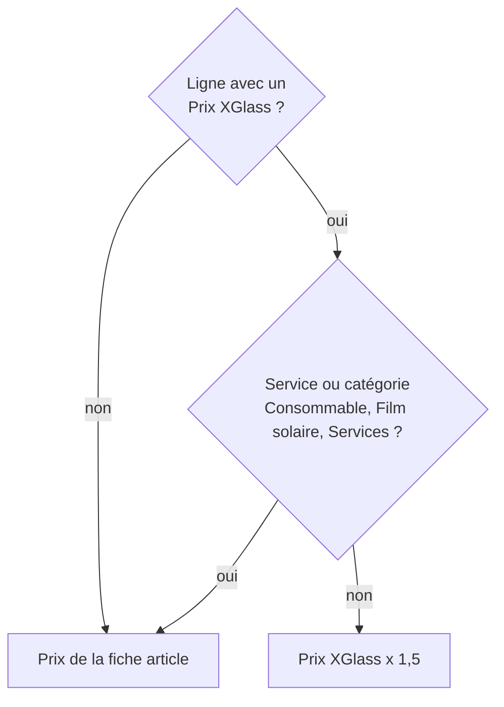

# Questions fréquentes

[RPBM Pricing](../../README.md) › [Documentation](../README.md) › [Manuel utilisateur](README.md) › Questions fréquentes

## Pourquoi ce prix ?

Si la ligne est déjà facturée, son prix n'est pas recalculé.

Pour contrôler, ouvrez la ligne et divisez le **Prix unitaire** par la colonne **Prix XGlass** : le résultat doit
valoir 1,5. La catégorie se lit sur la fiche de l'article, champ **Catégorie de produits**.

## Vendeurs

**Le bandeau jaune m'avertit d'une divergence. Je peux quand même confirmer ?**
Oui, rien ne bloque. Vérifiez d'abord l'assureur sur l'opportunité et le modèle de devis choisi.

**Le champ « Régime du dossier » est vide.**
Le devis n'a pas d'opportunité. Rattachez-le à un dossier.

**Un dossier hors assurance a le même prix que l'assurance.**
C'est normal pour l'instant. Le filtre qui l'évite n'est pas activé, dans l'attente de la validation du client.

**J'ai changé la quantité et mon prix saisi à la main a changé.**
Sur une ligne qui a un Prix XGlass, le prix unitaire est recalculé (Prix XGlass × 1,5) quand la quantité
change. Pour garder un autre prix, modifiez le Prix XGlass, pas le prix unitaire.

**Mon Prix XGlass saisi a disparu.**
Un correctif est en place. Si cela se produit encore, notez le numéro du devis et prévenez le support.

**La ligne de pose à domicile n'est pas là.**
Elle n'est ajoutée que par **Ajouter l'expédition** avec le mode de livraison **Pose sur site (Camion)**. Le
bouton est masqué si le devis n'a pas de ligne, si toutes les lignes sont des services, ou si l'expédition est
déjà ajoutée. Voir [Vendeurs](vendeurs.md#la-pose-à-domicile).

**Je ne peux pas confirmer : « Sélectionnez un transporteur / mode de remise ».**
Choisissez le **Mode de livraison** du devis (**Pose sur site (Camion)** pour une pose à domicile), puis confirmez.

**Je ne vois pas le menu Colisages VSF.**
Il est réservé aux achats. C'est voulu.

## Acheteurs

**La demande de prix est partie chez le client.**
Ce n'est plus possible avec le module. Vérifiez qu'il est installé, puis les prix fournisseurs de l'article.

**Mes nouvelles pièces ne s'ajoutent pas à ma demande de prix.**
Elle est en mode **Bateau** : elle ne reçoit plus les besoins automatiques. Une autre demande de prix en
Avion a été créée. Voir [Acheteurs](acheteurs.md#le-brouillon-bateau).

## Colisages et coefficient

**Un colisage a un coefficient à 0.**
Il n'a pas de pièces comptabilisées : facture MARCH non comptabilisée ou non rattachée. Ouvrez le colisage, onglet **Factures et avoirs** : toutes les factures doivent être à l'état Comptabilisé.

**Un colisage n'est pas « Retenu ».**
Ses pièces doivent dépasser 500 et ses frais 629. Ses factures doivent être comptabilisées et rattachées.

**La reprise liste des factures en exception.**
Rattachez-les à la main depuis la facture (champ **Colisage VSF**). Voir
[Colisages VSF](colisages-vsf.md#rattacher-une-facture-ou-un-avoir-à-la-main).

**Mon coefficient annuel diffère de mon classeur.**
Rattachez d'abord les avoirs. Voir [Colisages VSF](colisages-vsf.md#le-coefficient).

**Je relance la reprise : y a-t-il un risque de doublon ?**
Non. La seconde exécution ne change rien, sauf le recalcul des montants.

**Comment supprimer un colisage créé par erreur ?**
Seul un responsable des achats le peut (*Action › Supprimer* sur le colisage).

**Une facture COMPL n'a pas de MARCH.**
Rattachez-la à la main depuis la facture, avec le bon **Colisage VSF**.

**Un colisage Avion aurait dû être Bateau.**
Changez le champ **Mode** dans le formulaire du colisage, puis (responsable) relancez la reprise.

## Administrateurs

**La garde n'a pas pu être posée.**
La valeur de l'action a été modifiée à la main. Le module n'écrit rien. Voir
[Administrateur](administrateur.md#activer-la-garde-de-la-règle-8).

---
Précédent : [Administrateur](administrateur.md) · Suivant : [Pas encore disponible](pas-encore.md)
