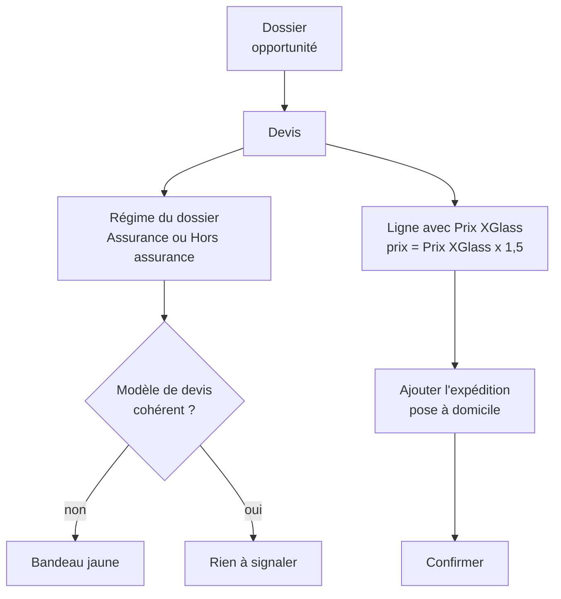

# Vendeurs

[RPBM Pricing](../../README.md) › [Documentation](../README.md) › [Manuel utilisateur](README.md) › Vendeurs

Ce que vous voyez et faites sur un devis. Un **dossier** est l'opportunité du CRM d'où vient le devis. Dans les
lignes du devis, la colonne à saisir s'appelle **Prix XGlass** (sans apostrophe).

## Le régime du dossier

Sur le devis, le champ **Régime du dossier** se trouve juste après **Modèle de devis**. Il se remplit tout
seul et ne se modifie pas.

| Valeur | Quand |
|---|---|
| Assurance | l'opportunité porte un assureur |
| Hors assurance | l'opportunité n'a pas d'assureur |
| Aucune valeur affichée | le devis n'a pas d'opportunité |

Chaque modèle de devis est rattaché à un régime. La liste se trouve dans *Ventes › Configuration › Modèles de
devis* (réservé aux administrateurs, réglage « Modèles de devis » activé) : vous n'avez rien à y changer. Les cinq
modèles « Pare brise V », « Lunette arrière », « Glace mobile », « Glace fixe » et « Réglage ADAS
(assurance) » sont rattachés à **Assurance**. Les modèles dont le nom contient « Hors assurance » sont rattachés
à **Hors assurance**. Le régime qui compte est toujours celui du **dossier**, pas celui du modèle.

## Le bandeau jaune

Au-dessus du devis, un bandeau jaune affiche l'un de ces deux textes. Il avertit, il ne bloque rien.

1. **Divergence** : le texte dit que le modèle de devis est d'un régime et le dossier de l'autre. Changez le
   **Modèle de devis** pour celui du régime du dossier, ou corrigez l'assureur sur l'opportunité.
2. **Main-d'œuvre sur un dossier hors assurance** : le texte parle de main-d'œuvre X'Glass proposée sur un
   dossier hors assurance. Les lignes de main-d'œuvre posées par le widget X'Glass suivent le barème
   assurance. Demandez à votre responsable de vérifier leurs montants.

## Le prix d'une ligne

Le prix d'une ligne est calculé à **1,5 fois le Prix XGlass**. Exemple : un Prix XGlass HT de 341,87 donne
512,805. Le prix n'est pas arrondi : il est gardé avec quatre décimales.

Ce qui n'est **pas calculé ainsi** (le prix reste celui de la fiche article) :

- les articles de type **service** ;
- les articles des catégories **Consommable**, **Film solaire** et **Services** ;
- les lignes sans Prix X'Glass (ou à zéro).

Pour l'instant, tous les dossiers, assurance ou non, ont le même prix : Prix XGlass × 1,5. **Ne corrigez pas
ce prix à la main.** Le client doit encore décider du prix hors assurance (un filtre existe, éteint :
[Administrateur](administrateur.md)).

### Quantité

Quand vous changez la quantité d'une ligne qui a un Prix XGlass, le prix unitaire est recalculé : Prix XGlass
× 1,5. Un prix unitaire tapé à la main est donc perdu. Pour garder un prix différent, modifiez le **Prix
XGlass**, pas le prix unitaire. Une ligne déjà facturée garde son prix.

## Saisir le Prix X'Glass à la main

Le widget X'Glass n'écrit pas encore le Prix XGlass HT : il faut le relever dans X'Glass et le saisir sur la
ligne. La colonne **Prix XGlass** est la seule à saisir.

1. Dans X'Glass, relevez le prix HT de la pièce.
2. Sur le devis, onglet **Lignes de la commande**, ajoutez l'article (**Ajouter un produit**).
3. Dans la colonne **Prix XGlass** de cette ligne, tapez le prix relevé.
4. Quittez la cellule : le **Prix unitaire** devient le Prix XGlass × 1,5 (341,87 donne 512,805).
5. Enregistrez le devis et vérifiez que le Prix XGlass est toujours là.

Depuis `rpbm_agent` 17.0.261013.1, le prix saisi sur une ligne neuve est conservé. Avant cette version, il
pouvait être perdu à l'enregistrement. Si cela arrive encore, notez le numéro du devis et prévenez le support.

## La pose à domicile

La pose à domicile (55,30 € HT) n'est **pas** ajoutée automatiquement. Elle l'est par le bouton
**Ajouter l'expédition** du devis, avec le transporteur **Pose sur site (Camion)**.

1. Sur le devis, vérifiez le champ **Mode de livraison** (le message d'erreur l'appelle « transporteur / mode de
   remise », la fenêtre d'expédition « transporteur » : c'est le même). Il est proposé d'après le lieu
   d'intervention de l'opportunité (« domicile » donne « Pose sur site (Camion) »).
2. Cliquez sur **Ajouter l'expédition**.
3. Dans la fenêtre, vérifiez que le transporteur est **Pose sur site (Camion)**, puis cliquez sur **Ajouter**.
4. Une ligne de pose à 55,30 € HT s'ajoute en bas des lignes du devis. Si la fenêtre propose **Mettre à jour**
   au lieu d'**Ajouter**, fermez-la : la ligne existe déjà.

À savoir :

- le bouton est masqué si le devis n'a pas de ligne, si toutes les lignes sont des services, ou si la ligne
  d'expédition existe déjà ;
- changer ensuite de transporteur ne met pas la ligne à jour ;
- sans mode de livraison, la confirmation est refusée : « Sélectionnez un transporteur / mode de remise avant de
  confirmer ».

## Après la confirmation

Après **Confirmer**, un bon de commande est préparé pour le fournisseur ([Acheteurs](acheteurs.md)). Pour le
voir, ouvrez la réception du devis. Vous n'avez rien à valider : c'est le travail de Yan et Mickaël.

Sur la facture client, le prix X'Glass de la pièce, le prix net fournisseur et la remise fournisseur
n'apparaissent jamais.

Voir aussi : [Garde de la règle 8](../technique/regle-8.md) · [Questions fréquentes](faq.md)

---
Précédent : [Manuel utilisateur](README.md) · Suivant : [Acheteurs](acheteurs.md)
